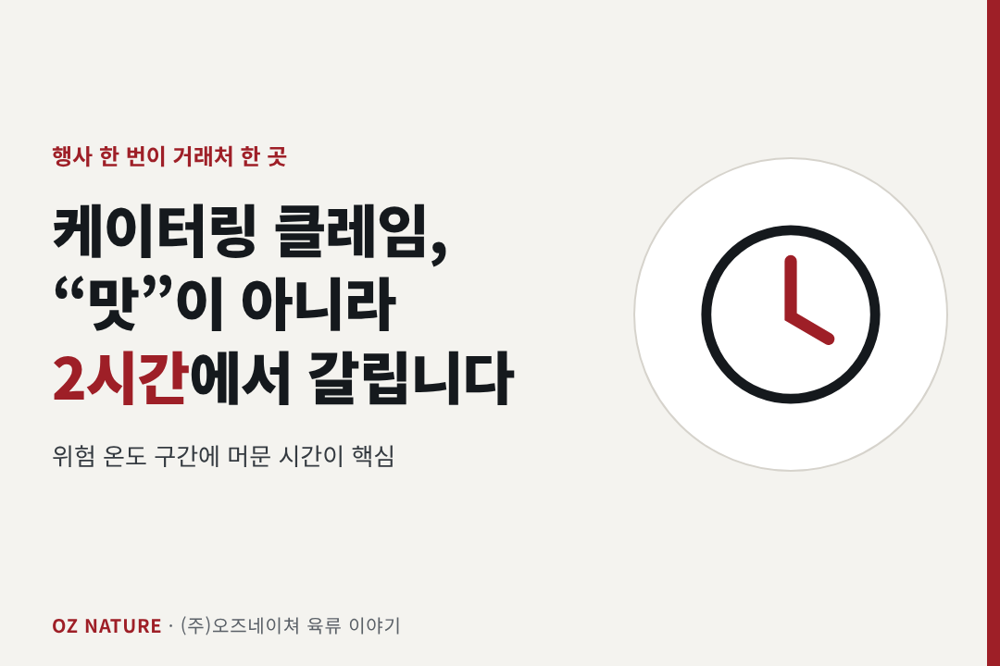
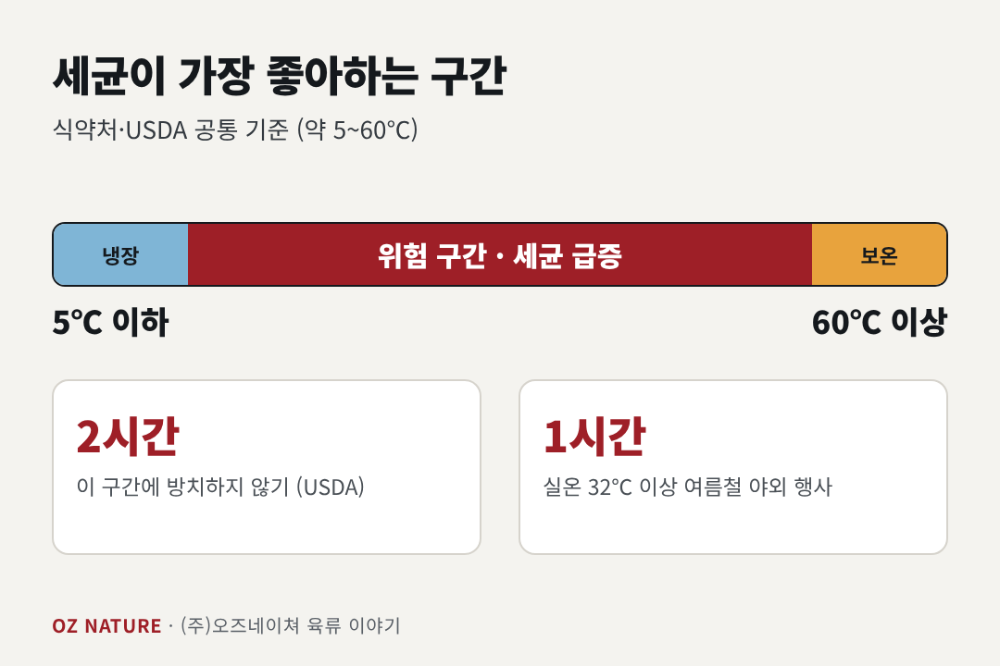
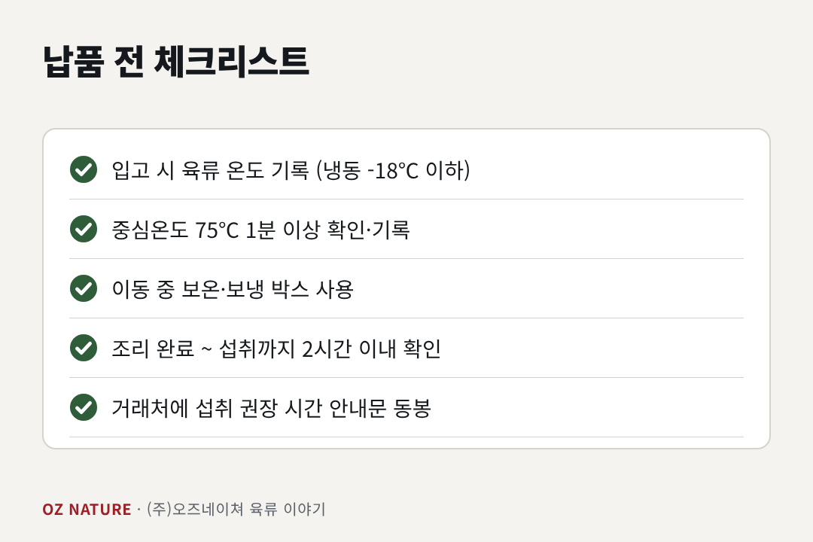

# 케이터링 클레임, 대부분 '맛'이 아니라 '2시간'에서 갈립니다

> 타깃: 케이터링·도시락·단체급식 납품업체 / 키워드: 케이터링 위생, 육류 보관 온도, 식중독 예방, 단체 납품 고기
> 발행: 2026-11-11(수)

---

**(주)오즈네이쳐**(충북 청주, 육류 도·소매 30년 업력)의 **육류 4년차 김현진 팀장**이 씁니다.

---

행사 한 번 잘못되면 거래처 한 곳을 잃습니다. 그리고 그 사고는 대개 조리 실력이 아니라 **음식이 머문 시간과 온도**에서 시작됩니다.
다른 케이터링 업체들은 이미 챙기고 있는 기준, 우리 팀은 현장에서 지켜지고 있나요?

## 1. 세균이 가장 좋아하는 구간

식약처와 미국 USDA 모두 식중독균이 빠르게 증식하는 구간을 알려줍니다.

- **위험 온도 구간: 약 5℃ ~ 60℃** (USDA는 4~60℃)
- 이 구간에 음식이 머무는 시간이 길수록 세균 수가 늘어납니다.
- USDA 기준 **2시간 이상 방치 금지**, 실온이 32℃ 이상인 여름철 야외 행사는 **1시간**입니다.

배송 차량 안, 행사장 대기 시간, 뷔페 라인 위. 케이터링은 이 구간에 머물 일이 구조적으로 많은 사업입니다.

## 2. 육류는 '가열'과 '유지' 두 번 확인

**① 충분히 가열했는가**
식약처 가이드는 가열 조리 식품의 중심온도를 **75℃에서 1분 이상**으로 안내합니다. 겉만 익은 상태로 포장하면 안 됩니다. 중심온도계로 가장 두꺼운 부위를 재세요.

**② 익힌 뒤 안전 온도를 유지했는가**
- 따뜻하게 보낼 음식: **60℃ 이상** 유지
- 차갑게 보낼 음식: **5℃ 이하** 유지
- 둘 다 아니라면 조리 후 **2시간 안에** 먹도록 시간 계획을 세웁니다.

## 3. 케이터링에 유리한 부위는 따로 있다

재가열하거나 보온 상태로 오래 둬야 하는 메뉴라면, 부위 선택이 품질을 가릅니다. 식품과학자 해롤드 맥기는 콜라겐이 많은 부위를 오래 가열하면 콜라겐이 젤라틴으로 바뀌어 **촉촉함이 유지된다**고 설명합니다. 안심·가슴살처럼 지방이 적은 부위는 보온 시간이 길어지면 쉽게 퍽퍽해집니다.

| 상황 | 상대적으로 유리한 부위 |
|---|---|
| 보온·재가열 메뉴 | 소 양지·사태, 돼지 앞다리·목살 같은 콜라겐/지방이 있는 부위 |
| 즉시 서빙 메뉴 | 안심·등심 같은 부드러운 부위 |

*부위별 구체적 적합도는 조리법에 따라 달라집니다.*

## 4. 납품 전 체크리스트

- [ ] 입고 시 육류 온도 기록 (냉장 / 냉동 -18℃ 이하)
- [ ] 중심온도 75℃ 1분 이상 확인 후 기록
- [ ] 이동 중 보온·보냉 박스 사용
- [ ] 조리 완료 시각 ~ 섭취 예상 시각 2시간 이내인지 확인
- [ ] 거래처에 **섭취 권장 시간** 안내문 동봉

기록 하나가 사고 났을 때 가장 큰 방어선이 됩니다.

---

*참고: 식품의약품안전처 식중독 예방 가이드 / USDA FSIS, Danger Zone (40°F–140°F) / Harold McGee, 『On Food and Cooking』*

---

## 오즈네이쳐 소개 (추가 1,000자 이내)

케이터링 담당자분들께 가장 부담스러운 건 "행사 당일 문제가 생기면 대안이 없다"는 점입니다. 물량이 늘어도, 날짜가 당겨져도 고기는 약속한 상태로 도착해야 합니다.

(주)오즈네이쳐는 충북 청주에서 약 30년간 육류 도·소매를 해온 기업입니다. 기업·공장·병원·학교 급식 위탁사와 케이터링 업체에 식단 규격에 맞춘 육류를 정기 공급하고 있습니다.

단체 납품에서 저희가 지키는 기준은 다음과 같습니다.

1. **온도 관리**: 입고 검수부터 냉장·냉동 보관 온도 기록, 냉장·냉동 차량 출고까지 콜드체인 유지
2. **정량 소분**: 식수와 조리 단위에 맞춰 포장해 현장 작업 시간을 줄임
3. **규격 일관성**: 메뉴별 두께·크기를 표준화해 매번 같은 규격으로 공급
4. **정시 입고**: 식단 일정에 맞춘 지정 시간 입고
5. **위생 서류 제공**: 이력번호, 원산지, 도축검사증명서, HACCP 인증서 등

냉동창고 4개소(약 80톤)에 대량 재고를 갖춰 정기 발주는 물론 물량 증가에도 대응합니다. 가격이 변동될 때는 미리 알리고 대체 부위를 제안드립니다.

케이터링·단체급식 납품 상담은 [연락처/문의 채널]로 문의해 주세요. 샘플로 품질과 규격을 먼저 확인하실 수 있습니다.

**(주)오즈네이쳐** | 충북 청주시 지동로 37 | [대표 연락처] | [스마트스토어 링크]
