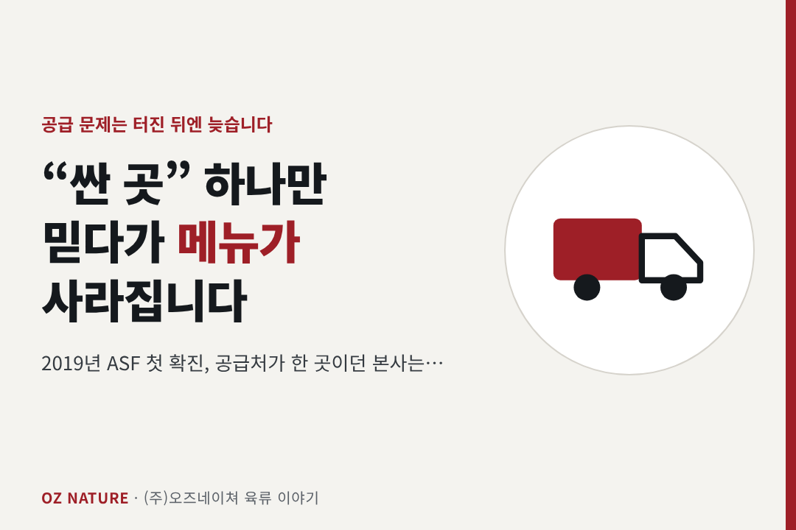
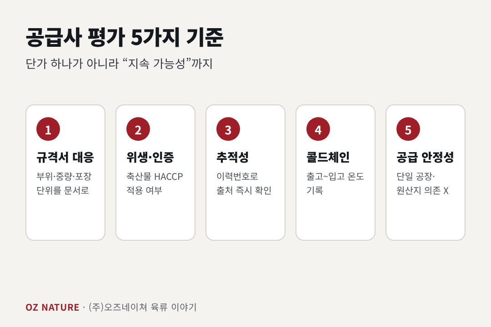
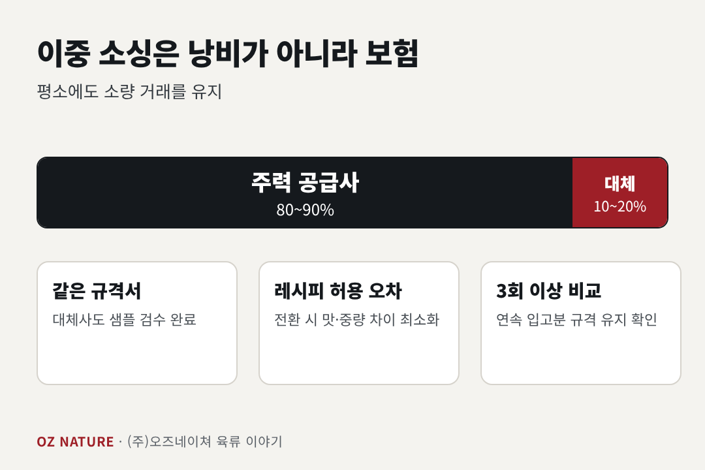

# 프랜차이즈 고기 공급사, '싼 곳' 하나만 믿다가 메뉴가 사라집니다

> 타깃: 프랜차이즈 본사 구매·SCM 담당자 / 키워드: 프랜차이즈 육류 공급, 식자재 공급업체 선정, 이중 소싱, 육류 규격서
> 발행: 2026-11-18(수)

---

**(주)오즈네이쳐**(충북 청주, 육류 도·소매 30년 업력)의 **육류 4년차 김현진 팀장**이 씁니다.

---

2019년 9월, 국내에서 아프리카돼지열병(ASF)이 처음 확진됐습니다. 그때 공급처가 한 곳뿐이었던 본사는 가격이 아니라 **물량**을 걱정해야 했습니다.
공급 문제는 터진 뒤에 대응하면 이미 늦습니다. 지금 우리 본사의 육류 공급 구조는 괜찮나요?

## 1. 단가표에 없는 비용: 공급 중단

가맹점 입장에서 메인 육류가 끊기면 단순한 결품이 아니라 **매출 중단**입니다. 가맹점 불만, 신뢰 하락까지 이어집니다. 질병 발생, 도축·가공 설비 문제, 물류 지연은 예측하기 어려운 변수입니다.

그래서 공급사 평가는 단가 하나가 아니라 **지속 가능성**까지 봐야 합니다.

## 2. 공급사 평가 5가지 기준

1. **규격서(스펙시트) 대응력**: 부위, 중량 범위, 지방 두께, 포장 단위까지 문서로 정하고 지키는가
2. **위생·인증**: 축산물 HACCP 적용 여부, 거래 가공장 정보 확인 가능 여부
3. **추적성**: 소·돼지는 축산물 이력제로 이력번호 추적이 가능합니다. 문제가 생겼을 때 어디서 온 고기인지 즉시 확인되는가
4. **콜드체인**: 출고·운송·입고 온도 기록을 남기는가
5. **공급 안정성**: 단일 원산지·단일 공장에 의존하지 않는가

## 3. '이중 소싱'은 낭비가 아니라 보험

주력 공급사 + 대체 공급사를 미리 정해두는 구조입니다. 모든 물량을 반으로 나누라는 뜻이 아닙니다.

- 주력 80~90%, 대체 10~20%로 **평소에도 소량 거래**를 유지
- 대체 공급사도 **같은 규격서**로 샘플 검수를 마쳐 둠
- 전환 시 맛·중량 차이를 최소화할 수 있도록 **레시피 허용 오차** 사전 정의

대체 공급사와 한 번도 거래한 적이 없다면, 위기 때 바로 쓸 수 없습니다.

## 4. 도입 전 샘플 테스트는 이렇게

- 같은 부위를 **같은 조건**에서 조리해 비교 (온도·시간 고정)
- 입고 중량 대비 조리 후 중량으로 **수율** 계산
- 3회 이상 연속 입고분에서 규격이 유지되는지 확인

한 번 좋은 샘플보다 **여러 번 같은 품질**이 더 중요합니다.

---

*참고: 농림축산식품부 ASF 발생 관련 발표(2019.9) / 축산물 위생관리법(HACCP) / 가축 및 축산물 이력관리에 관한 법률*

---

## 오즈네이쳐 소개 (추가 1,000자 이내)

프랜차이즈 본사가 공급사에 기대하는 것은 결국 하나입니다. **"어느 매장, 어느 날에도 같은 고기가 온다."**

(주)오즈네이쳐는 충북 청주에서 약 30년간 육류 도·소매를 해온 기업입니다. 수입사·도축장·가공장과 오랜 기간 쌓은 거래 관계로 시세 변동기에도 물량과 단가를 안정적으로 확보하는 데 집중해 왔습니다. 현재 누적 거래처는 500곳이 넘고, 대기업 계열사 단체급식 현장에도 계약 납품을 하고 있습니다.

오늘 글의 평가 기준에 비춰 저희의 현황을 정리하면 다음과 같습니다.

- **규격 대응**: 부위·두께·중량·포장 단위를 거래처별로 맞춰 가공
- **위생·인증**: HACCP 인증 2건(식육가공업·식육포장처리업)
- **추적성**: 이력번호와 원산지 등 납품 서류 제공
- **콜드체인**: 냉장·냉동 차량 출고
- **물량 안정성**: 냉동창고 4개소(약 80톤) 상시 재고, 수입육과 국내산 한돈 모두 취급

거래 전에는 규격 협의, 샘플 검수, 소량 시범 납품 순으로 확인하시길 권합니다. 필요하시면 주력·보조 공급 구조를 함께 설계할 수 있습니다. 취급 부위와 원산지는 시기별 수급에 따라 달라질 수 있어서, 상담 때 현재 가능한 범위를 솔직하게 말씀드립니다.

프랜차이즈 육류 공급 검토나 대체 공급처 문의는 [연락처/문의 채널]로 연락 주세요.

**(주)오즈네이쳐** | 충북 청주시 지동로 37 | [대표 연락처] | [스마트스토어 링크]
