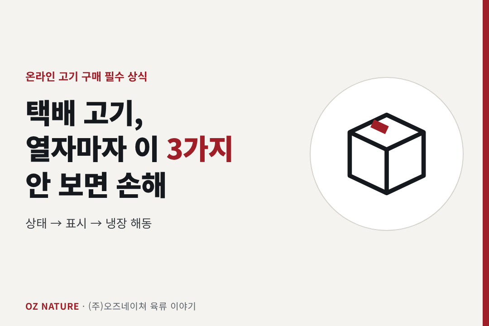
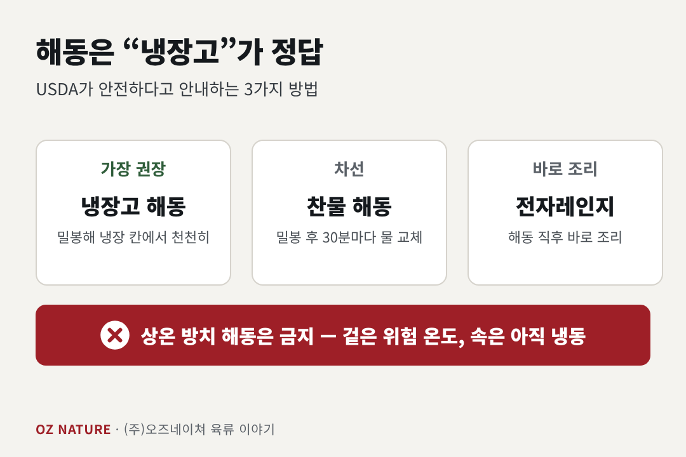
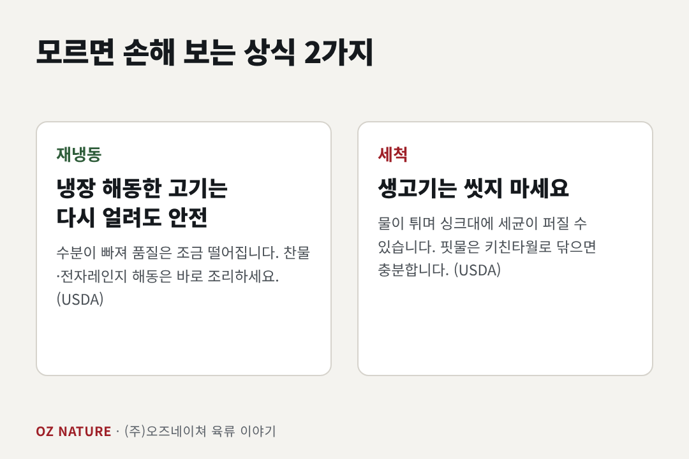

# 택배로 온 고기, 열자마자 이 3가지 안 보면 손해입니다

> 타깃: 온라인 육류 구매 소비자(네이버 스토어 잠재 고객) / 키워드: 택배 고기 받으면, 냉동육 해동법, 소비기한, 고기 재냉동
> 발행: 2026-11-25(수)

---

**(주)오즈네이쳐**(충북 청주, 육류 도·소매 30년 업력)의 **육류 4년차 김현진 팀장**이 씁니다.

---

온라인으로 고기를 자주 시키는 사람들은 상자를 열자마자 확인하는 것이 있습니다. 모르고 넘기면 맛도, 안전도, 돈도 손해입니다.

## 1. 상태부터: 냉동이면 '단단히' 얼었나

냉동육은 받았을 때 표면과 속까지 단단히 얼어 있어야 합니다. 일부만 녹았다가 다시 얼면 품질이 떨어집니다. 확인할 것은 다음과 같습니다.

- 포장이 찢기거나 부풀지 않았는가
- 포장 안에 핏물이 과하게 고여 있지 않은가
- 얼음 결정이 지나치게 많이 끼어 있지 않은가
- 냉장육은 아이스팩이 아직 차가운가

문제가 있다면 **버리기 전에 사진부터** 찍어 판매처에 문의하세요.

## 2. 표시사항: '소비기한'을 보세요

2023년 1월 1일부터 식품에는 유통기한 대신 **소비기한**이 표시됩니다. 소비기한은 보관 조건을 지켰을 때 먹어도 안전한 기한입니다. 같이 확인할 정보는 다음과 같습니다.

- 소비기한
- 보관 방법(냉장/냉동)
- 원산지
- 축산물 이력번호(소·돼지)

이력번호는 축산물이력제 조회 사이트나 앱에서 입력하면 출처를 확인할 수 있습니다.

## 3. 해동은 '냉장고'가 정답

USDA가 안전하다고 안내하는 해동법은 3가지입니다.

1. **냉장고 해동** (가장 권장)
2. **찬물 해동** (밀봉 후 30분마다 물 교체)
3. **전자레인지 해동** (해동 직후 바로 조리)

**상온 방치 해동은 금지입니다.** 겉은 위험 온도 구간에 들어가는데 속은 아직 얼어 있기 때문입니다.

## 모르면 손해 보는 상식 2가지

- **냉장고에서 해동한 고기는 다시 얼려도 안전합니다.** 다만 수분이 빠져 품질은 조금 떨어집니다(USDA). 찬물·전자레인지로 해동한 고기는 바로 조리하세요.
- **씻지 마세요.** USDA는 생고기를 물로 씻는 것을 권하지 않습니다. 물이 튀면서 싱크대와 주변에 세균이 퍼질 수 있습니다. 핏물은 키친타월로 닦으면 충분합니다.

## 오늘 정리

받자마자 **상태 → 표시 → 냉장 해동**. 이 순서만 지켜도 온라인으로 산 고기를 훨씬 안전하고 맛있게 드실 수 있습니다.

---

*참고: USDA FSIS, Safe Thawing / Washing Food: Does it Promote Food Safety? / 식품 등의 표시·광고에 관한 법률(소비기한 표시제)*

---

## 오즈네이쳐 소개 (추가 1,000자 이내)

온라인에서 고기를 사는 건 생각보다 용기가 필요한 일입니다. 눈으로 볼 수도, 만져볼 수도 없으니까요. 그래서 판매자가 **어떤 곳인지**가 중요하다고 생각합니다.

(주)오즈네이쳐는 충북 청주에서 약 30년간 육류 도·소매를 해온 기업입니다. 수입육과 국내산 한돈을 다루며 단체급식, 식당, 프랜차이즈에 공급해 왔고, 그 기준을 [네이버 스마트스토어 이름]의 가정용 소포장 정육에도 그대로 적용합니다.

저희가 지키려는 것은 다음과 같습니다.

- **상태**: 냉장·냉동 구분 보관, HACCP 시설에서 가공·진공 포장
- **표시**: 소비기한, 원산지, 보관 방법, 이력번호 안내
- **배송**: 온도를 유지한 택배 출고 [포장 구성·배송 소요일]
- **안내**: 부위별 추천 요리와 굽는 법 [상세페이지/문의 응대]

오늘 글처럼 받자마자 확인하는 방법을 아시면, 저희 상품도 기준에 맞는지 직접 보실 수 있습니다. 부족한 부분은 [교환·환불 안내]로 책임지겠습니다.

어떤 부위를 사야 할지 모르겠다면 요리 종류와 인원수만 남겨주세요. 맞는 부위를 안내해 드립니다.

**(주)오즈네이쳐** | 충북 청주시 지동로 37 | [대표 연락처] | [스마트스토어 링크]
